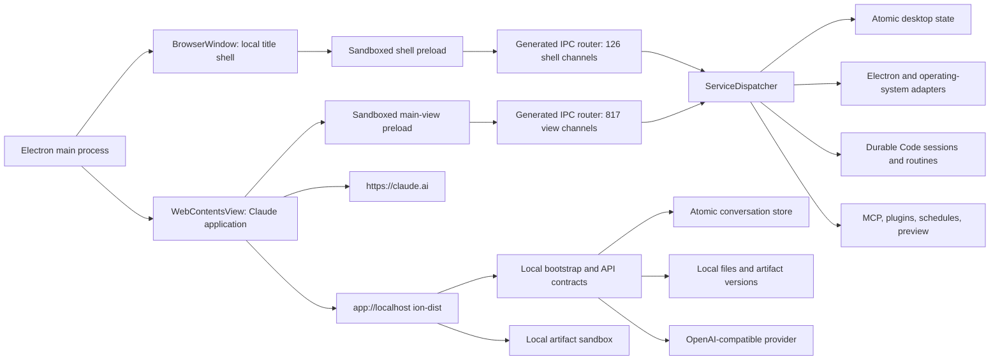

# Architecture

The observed desktop application is an Electron security shell around either Anthropic's hosted SPA or a packaged third-party SPA. The reconstruction keeps the same separation.

The preload channel sets overlap, so 126 plus 817 is greater than the 842 distinct-channel total.

## Main process

[`src/main/index.ts`](../src/main/index.ts) owns application lifecycle, single-instance locking, window creation, the child view, bounds synchronization, deep links, menu removal, navigation rules, permissions, and mode selection. The window shell is a local file; the application view is a trusted remote origin or `app://localhost`.

The parent `BrowserWindow` never receives remote content. The remote or packaged application runs in a child `WebContentsView` with `sandbox: true`, `contextIsolation: true`, and `nodeIntegration: false`.

## Preloads and IPC

[`src/preload/expose-contract.ts`](../src/preload/expose-contract.ts) constructs namespaces from the recovered contract. It exposes functions only when the initial/top-level renderer URL is trusted. Invoke, event, and synchronous operations preserve their observed transport behavior.

[`src/main/ipc.ts`](../src/main/ipc.ts) independently checks the sender again. The local shell must be the exact built `dist/index.html`; arbitrary `file:` pages cannot call privileged IPC. Primitive and optional argument guards come from the generated bundle's validation failures. Structural validators are recorded but are not falsely presented as fully recovered schemas.

## Services and state

[`src/main/services.ts`](../src/main/services.ts) implements high-confidence desktop behaviors and routes unknown or unavailable operations to stable safe defaults. This keeps the web client bootable without pretending that local-agent, VM, simulator, Office, device-attestation, or backend services can be recovered from interface names alone.

[`src/main/state.ts`](../src/main/state.ts) maintains the reconstructed settings store. Every update is serialized and written through a same-directory temporary file followed by rename, preventing partially written JSON.

Main-process managers own every capability that can touch the filesystem,
launch a process, access the network, control a browser, or inject input. The
preload adapts presentation but does not persist data or acquire new authority.
The detailed keep/trim/port rules are in
[`product-boundary.md`](product-boundary.md).

## Local SPA protocol

[`src/main/local-ui.ts`](../src/main/local-ui.ts) serves the installed `ion-dist` from `app://localhost`. It provides:

- decoded-path containment checks;
- regular-file checks and SPA fallback;
- MIME types and `nosniff`;
- a strict CSP with hashes for inline boot scripts;
- original-style `/edge-api/` normalization;
- bootstrap, access, settings, plugin, marketplace, health, and i18n-compatible responses;
- fail-closed, version-specific in-memory route patches that restore the retained new-chat and conversation components;
- routing of conversation, attachment, artifact-version, and completion calls into [`src/main/local-backend.ts`](../src/main/local-backend.ts);
- a separate `app://artifacts.local` renderer that previews supported artifacts without remote code or network access;
- a JSON 503 `custom_3p_not_available` response for unstubbed APIs rather than accidentally returning HTML.

The local backend persists conversation trees, uploaded files, and artifact versions independently. It translates an OpenAI-compatible streaming response and function calls into the SSE/content-block sequence consumed by the packaged client. [`src/preload/local-workbench.ts`](../src/preload/local-workbench.ts) adds a small isolated provider configuration surface without editing vendor markup or assets.

## Filesystem boundary

Remote content cannot read or write an arbitrary supplied path. [`src/main/file-access.ts`](../src/main/file-access.ts) issues in-memory capabilities only for files or directories returned by a native user picker or created by a controlled download/paste flow. Existing paths are canonicalized with `realpath`; root containment is checked after symlink resolution. Writes may create a file only beneath an already granted canonical root.

Open-Claude project configuration is namespaced under `.open-claude`. The `.claude` directory is reserved for Anthropic Claude and is excluded from model file/search tools; the standalone runtime neither imports nor migrates it. Retained-client path strings are rewritten in memory with exact-count release gates so native dev-server, customization, plugin, worktree, and memory surfaces point only at the Open-Claude namespace.

Downloads accept only trusted application origins, use sanitized base names, choose a collision-free path, and use exclusive creation. Local reads are limited to 50 MiB.

## Navigation and permissions

Allowed application origins are `claude.ai`, `preview.claude.ai`, `claude.com`, their preview host, and `app://localhost`. Development origins require an explicit environment switch. Non-application HTTP(S), mail, telephone, and SMS links leave Electron through the operating-system shell. Unknown schemes are denied.

Permission checks require both the requesting URL and the owning top-level web contents to be trusted. Main-frame web requests are also guarded, giving a second layer behind `will-navigate` and `setWindowOpenHandler`.
