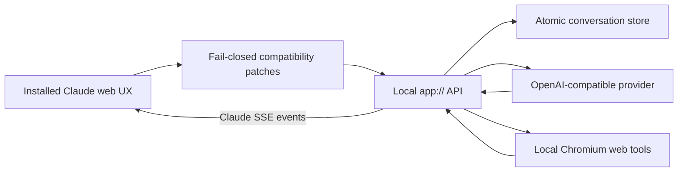

# Local Claude UX mode

Local mode uses a private snapshot of the web application shipped with the compatible Claude Desktop build as the presentation layer and replaces the server boundary with independently authored local code. The installed frontend is read only while creating the first private snapshot; subsequent runs serve `%AppData%\Open-Claude\UI Assets`. Nothing is written into the installed application or its profile, and the snapshot is not redistributed by this repository.



## Start and configure

```powershell
npm start
```

The default endpoint is `http://127.0.0.1:11434/v1`, which is suitable for an Ollama OpenAI-compatible server. **Settings → Local model** opens an isolated configuration panel that can change the endpoint, model, and optional bearer token and can discover models through `GET /models`.

Environment variables override persisted settings:

| Variable                    | Purpose                                          |
| --------------------------- | ------------------------------------------------ |
| `CLAUDE_ION_DIST`           | Alternate unpacked `ion-dist` directory          |
| `CLAUDE_DESKTOP_LOCAL_UI`   | `0` opts into hosted compatibility mode          |
| `CLAUDE_LOCAL_BASE_URL`     | Provider URL through `/v1`                       |
| `CLAUDE_LOCAL_MODEL`        | Model identifier sent to the provider            |
| `CLAUDE_LOCAL_API_KEY`      | Optional bearer token                            |
| `OPEN_CLAUDE_USER_DATA_DIR` | Alternate Open-Claude profile and data directory |

Provider configuration, conversations, artifact metadata/versions, and uploaded-file metadata live in `local-backend.json` beneath Electron's user-data directory. Uploaded bytes are kept separately under `local-files/`. JSON writes use a same-directory temporary file and atomic rename. The API key is never returned to the renderer; the settings API exposes only whether one is stored.

The application identity is **Open-Claude** with its own Windows taskbar ID, `open-claude://` deep-link namespace, single-instance lock, startup entry, and `%AppData%\Open-Claude` profile. Electron session data, cache, logs, and crash dumps are all children of that profile. It never shares `%AppData%\Claude` with Anthropic Claude Desktop.

Local mode does not require sign-in. The packaged client still needs an internal account/organization-shaped compatibility object to construct its query graph, but the account control is hidden and no authentication workflow, Claude credential, or hosted account is used.

## Local OAuth connectors

**Settings → Connectors** has guided presets for Gmail, Google Drive, and Slack. These do not use an Open-Claude account, relay, proxy, or cloud service. The user owns the OAuth application and signs in directly on the provider's site; Open-Claude then calls the provider's official MCP endpoint from the desktop process.

- Gmail and Google Drive use a Google **Desktop app** OAuth client and an ephemeral `127.0.0.1` PKCE callback. Enable the corresponding Workspace API and MCP API, create the desktop client, then paste either its client ID or the contents of Google's downloaded OAuth JSON.
- Slack uses an internal Slack app with MCP and PKCE enabled. Add `open-claude://oauth/slack` as its redirect URL, then paste the app's client ID. A client secret is optional for providers or app policies that require one.
- Read-only permissions are the default. “Allow write actions” explicitly switches to the provider's write-capable scope set.
- Access tokens, refresh tokens, and client secrets are encrypted with Electron `safeStorage` in `local-mcp-oauth.json`. If OS credential encryption is unavailable, OAuth setup fails closed. Tokens are supplied to MCP requests only in the main process and are never returned to page JavaScript.
- Expiring access tokens refresh locally. An authenticated MCP request rejected with `401` or `403` gets one forced refresh and one retry; a second rejection asks the user to reconnect.

Removing a preset connector also removes its local encrypted credentials. Custom unauthenticated streamable-HTTP MCP endpoints remain available through **Add custom**. The three presets intentionally lock their URLs to the providers' official endpoints, so changing a preset into an arbitrary token-collecting server is rejected.

## Reconstructed web contracts

The packaged client is bootstrapped with a stable synthetic account and organization. The local server currently implements:

- account bootstrap, access, model selector, privacy-consent, and notification-preference responses;
- conversation creation, listing, search, starring, rename, deletion, tree loading, and local title responses;
- initial and follow-up completion routes;
- translation from OpenAI streaming deltas into the Claude client's `message_start`, `conversation_ready`, content-block, message-delta, and `message_stop` events;
- translation of the recovered Claude artifact tool into an OpenAI function tool, including persistent `create`, `rewrite`, and `update` versions;
- execution of model-requested `web_search` and `visit_website` calls through the local Chromium runner, with visible, persistent web activity and source metadata in Chat;
- local artifact listing/version APIs plus an `app://artifacts.local` sandbox for HTML, SVG, Markdown, text, and code previews;
- multipart document conversion/upload, local file persistence, file preview/download, and attachment metadata in conversation trees;
- persistence before and after provider execution so a reload reconstructs the conversation.

The provider request contains the configured model and text history as OpenAI `user` and `assistant` messages. UTF-8/UTF-16 text, source code, CSV, JSON, HTML, SVG, and Markdown attachments are extracted locally and included in the user message. Other binary formats can be stored, but are represented to a text-only provider as binary metadata until a format-specific parser or vision adapter is added.

HTML and SVG artifacts render entirely inside the local sandbox. Markdown, plain text, and code have native local renderers. React and Mermaid artifacts currently show their source with an explicit fallback notice rather than loading a remote runtime. Web search and page visits run locally and do not use Anthropic's hosted search service. Claude-hosted billing and Anthropic-managed connectors remain unavailable; local streamable-HTTP MCP connectors and the three user-owned OAuth presets above are supported. The Cowork surface is removed; stale Cowork HTTP calls fail explicitly with `410`, while other unknown server APIs fail closed with a JSON `503` response.

## Frontend compatibility layer

The retained frontend still contains the ordinary Claude chat components, but its desktop route table can redirect `/new` and `/chat/:uuid` into an unavailable task surface. Local mode applies exact, fail-closed in-memory transformations while serving the installed JavaScript:

1. define a stable route component around the retained conversation renderer;
2. restore `/new` and `/chat/:uuid` to the retained web-chat components;
3. keep the new-chat route in web-chat mode;
4. defer initial completion until after navigation so the conversation route owns the stream;
5. disable service-worker cleanup on the custom `app://` protocol;
6. permit the retained conversation-tree query in third-party mode;
7. point artifact previews at the local sandbox;
8. derive staged composer files into persistent local file references before send.

Every transformation must match exactly once across the module graph declared by `index.html`. Startup aborts when a marker is missing or duplicated. This makes a changed vendor build an explicit compatibility failure instead of silently patching the wrong code. The files in the Claude installation are never modified.

## What “reverse engineered” means here

Client behavior, wire contracts, persistence rules, and desktop IPC can be derived from code shipped to the machine and from runtime observation. Anthropic's server implementation and original unminified source are not present in the desktop package, so they cannot literally be decompiled. The local backend is a behavioral reimplementation of the contracts the shipped client consumes.
